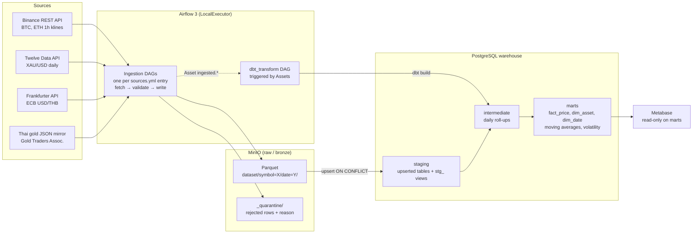
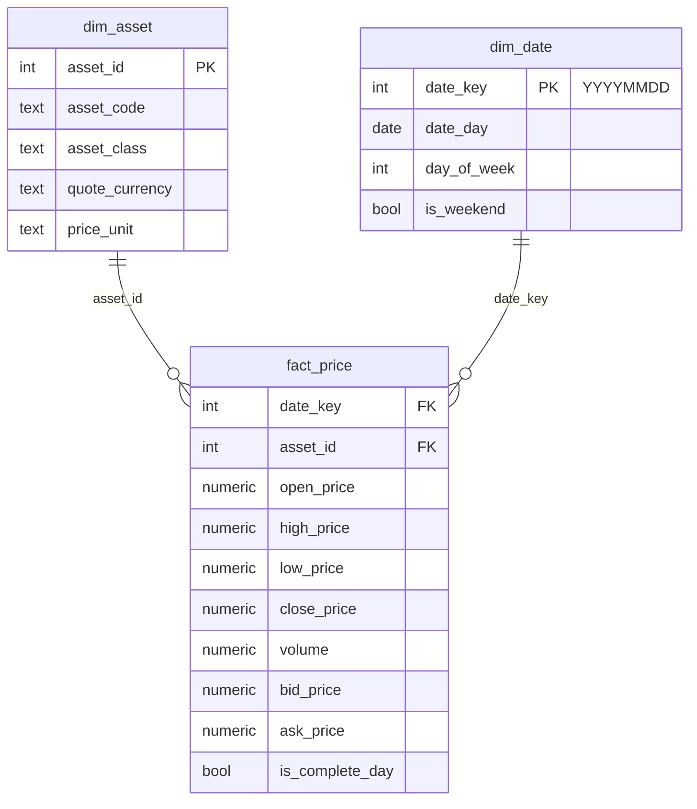

# Market Data Pipeline: crypto, FX and Thai gold

[](https://github.com/stampnapat/market-data-pipeline/actions/workflows/ci.yml)

An end-to-end **batch data pipeline** that ingests Binance crypto candles, spot gold,
USD/THB reference rates and Thai 96.5% gold prices every day, lands them as Parquet in an
S3-compatible lake, loads them into a Postgres warehouse and models them with dbt
into a star schema and analytical marts for a Metabase dashboard.

Everything runs locally and free with `docker compose up`. The focus is data
engineering practice: **idempotent loads, backfills, layered modelling, data
quality gates, data-aware orchestration and CI**, not just charts.

## Architecture



| Layer | Where | What |
|---|---|---|
| Raw (bronze) | MinIO `raw/` | Parquet, one file per `(symbol, date)`; rewritten on re-run |
| Staging | Postgres `staging` | Python-loaded tables (upsert on natural key) + dbt `stg_` views |
| Intermediate | Postgres `intermediate` | hourly → daily OHLCV, last Thai gold announcement per day |
| Marts (gold) | Postgres `marts` | star schema + analytical marts, the only schema Metabase can read |

## Data sources

| Source | Data | Cadence | Notes |
|---|---|---|---|
| [Binance](https://developers.binance.com/docs/binance-spot-api-docs/rest-api) `/api/v3/klines` | BTCUSDT, ETHUSDT 1h OHLCV | daily, 24 candles/day | no key; open candles are rejected at ingestion |
| [Frankfurter](https://frankfurter.dev) | USD/THB (ECB reference rate) | business days | no key; API snaps weekends to Friday, which we filter out |
| Third-party mirror of the [Gold Traders Association](https://www.goldtraders.or.th) | 96.5% gold bar and ornament, dealer buy/sell | last announcement per day | association site is client-rendered with no public API; **latest only, no history** |
| [Twelve Data](https://twelvedata.com/docs/market-data/time-series) `/time_series` | XAU/USD spot gold | business days | free API key in `.env`, 8 requests/min; key sent in a header; flat weekend bars dropped in dbt |

Current volumes: 90+ days of hourly candles and of daily gold and FX, Thai gold
accumulating daily since 2026-11-05.

## Quick start

Requirements: Docker Desktop (≥ 6 GB RAM for Docker), Python 3.12 and
[uv](https://docs.astral.sh/uv/) for local development.

```bash
git clone https://github.com/stampnapat/market-data-pipeline.git
cd market-data-pipeline
cp .env.example .env                 # then replace every change_me_* value
docker compose up -d                 # Postgres, MinIO, Airflow, Metabase
docker compose ps                    # wait until everything is healthy
```

| Service | URL | Login |
|---|---|---|
| Airflow | http://localhost:8080 | `AIRFLOW_ADMIN_USER` / `AIRFLOW_ADMIN_PASSWORD` |
| MinIO console | http://localhost:9001 | `MINIO_ROOT_USER` / `MINIO_ROOT_PASSWORD` |
| Metabase | http://localhost:3000 | created on first visit, see [docs/metabase.md](docs/metabase.md) |

Ports are bound to `127.0.0.1` only.

### Load history (backfill)

In Airflow, unpause `binance_klines`, `fx_rates`, `thai_gold` and `dbt_transform`, then:

```bash
docker compose exec airflow-scheduler airflow backfill create \
  --dag-id binance_klines --from-date 2026-08-07 --to-date 2026-11-04
docker compose exec airflow-scheduler airflow backfill create \
  --dag-id fx_rates --from-date 2026-08-07 --to-date 2026-11-04
```

Each run fetches exactly its UTC day. `dbt_transform` runs automatically after
loads. Re-running a range is safe (see *Idempotency*). The Thai gold source has
no history, so it can't be backfilled.

### Dashboard

Follow [docs/metabase.md](docs/metabase.md): connect Metabase to the warehouse as
`metabase_reader`, then build the dashboard from code with
`python scripts/setup_metabase.py`.

### Local development

```bash
uv venv --python 3.12 .venv && source .venv/bin/activate
uv pip install -e ".[dev,dbt]"
set -a; source .env; set +a

pytest                                 # 52 unit tests, no network or services
ruff check . && ruff format --check .
cd dbt && dbt build --profiles-dir .   # models + data tests against local Postgres
dbt docs generate --profiles-dir . && dbt docs serve --profiles-dir . --port 8081
```

## Project structure

```
config/sources.yml        one entry per dataset → one ingestion DAG
dags/
  ingest_sources.py       DAG factory: fetch → validate → MinIO → staging (+ Asset)
  dbt_transform.py        dbt build + source freshness, scheduled on Assets
  pipeline_assets.py      shared Asset definitions
src/ingestion/
  datasets.py             DatasetSpec: key, schema, staging DDL, row checks per dataset
  sources/                Source contract + Binance, Twelve Data, Frankfurter, Thai gold, registry
  validation.py           row rules, dedup, quarantine, failure threshold
  storage/minio.py        partitioned Parquet writer (overwrite = idempotent)
  storage/postgres.py     generic upsert loader (one transaction per run)
dbt/
  models/staging/         sources + stg_ views (rename, cast, derive)
  models/intermediate/    daily OHLCV roll-up, Thai gold daily close
  models/marts/core/      fact_price, dim_asset, dim_date
  models/marts/analytics/ moving averages, volatility, BTC-gold correlation, Thai premium
  tests/                  generic + singular data tests
  seeds/                  asset_reference.csv
tests/                    pytest with saved API responses (fixtures/)
infra/postgres/init.sh    databases, layer schemas, least-privilege roles
scripts/                  completeness check, CI table setup, Metabase dashboard-as-code
.github/workflows/ci.yml  ruff, pytest, dbt build on a fresh Postgres
```

## Data model



`fact_price` grain: **one row per asset per day**. Sources with different
granularity are normalised: crypto rolls hourly candles up to real daily OHLCV;
FX has one fixing per business day (O = H = L = C); Thai gold keeps the day's last
announcement with dealer buy/sell as bid/ask. It is an **incremental** model
(delete + insert on `(asset_id, date_key)`) that re-processes every day whose source
rows were loaded since the last build, plus a 3-day lookback by date.

Analytical marts: `mart_moving_averages` (7/30-observation SMAs, NULL until the
window is full, trend label), `mart_daily_volatility` (daily return, intraday
range, 30-observation volatility of log returns, annualized with 365 or 252),
`mart_btc_gold_correlation` (30-observation correlation of BTC and gold log returns
on days both trade) and `mart_thai_gold_premium` (Thai bar sell price vs. spot value
in THB: XAU × USDTHB × 15.244 g × 0.965 / 31.1035 g per oz, as-of joined to the
latest spot and FX at most 4 days old).

What the first weeks of data show (early November 2026):

| Metric | Value |
|---|---|
| Thai gold bar premium over spot | about **+0.27 %** (~175 THB per baht-weight) |
| 30-day correlation, BTC vs. gold daily returns | **0.36** (range 0.23 to 0.62 over the period) |
| Annualized volatility | gold ~25 %, BTC ~36 %, ETH ~49 % |

## Data quality

| Where | Check | On failure |
|---|---|---|
| Ingestion | required fields, price > 0, low ≤ open/close ≤ high, volume ≥ 0, candle closed, sell ≥ buy | row goes to `raw/_quarantine/` with a reason |
| Ingestion | exact duplicates collapsed; conflicting duplicates on the key quarantined | |
| Ingestion | > 5 % defective rows, or an unexpectedly empty batch | **task fails** (loud, not silent) |
| Postgres | primary key on every staging table | upsert can't create duplicates |
| dbt | unique / not_null / accepted_values / relationships on keys and FKs | `dbt build` stops downstream models |
| dbt | composite-key uniqueness, `positive`, OHLC consistency, FX never on weekends | |
| dbt | no missing crypto day (calendar LEFT JOIN), 24 candles per day (warn), FX plausibility band (warn) | |
| dbt | source freshness per cadence (Binance 26 h, FX 4 days, Thai gold 3 days) | separate red task, marts still build |

## Design decisions and trade-offs

**PostgreSQL over DuckDB.** Airflow tasks, dbt and Metabase read and write
concurrently; DuckDB is a single-writer file and needs a community Metabase driver.
Postgres is slower for scans, which doesn't matter at this volume.

**No Spark.** About 17k rows a year. Spark would add a cluster's worth of
complexity for no benefit; the medallion layout and MERGE semantics carry over
without it.

**Idempotency at every layer.** Raw files are addressed by `(dataset, symbol,
date)` and overwritten; staging upserts on the natural key inside one
transaction; `fact_price` deletes and re-inserts its keys. Re-running a 90-day
backfill left row counts unchanged and produced no duplicate keys.

**Parquet without a table format.** MinIO holds plain Parquet, which has no ACID
guarantees: a run that fails half-way can leave one symbol's file written and
not the other. Accepted because the next run overwrites both and staging loads are
transactional. Delta Lake or Iceberg would remove this gap (see future work).

**One file per symbol per day (small files).** 24 rows per file is the classic
small-file problem, accepted because it makes "re-run one day" a single overwrite
and lets backfill runs proceed in parallel without contention. Compaction would
fix it at scale.

**Config-driven sources.** A `DatasetSpec` holds everything that differs per
dataset (key, schema, DDL, row checks, whether empty is normal). Validation,
storage, loading and the DAG factory are generic, so adding FX and Thai gold
needed a source class and a YAML entry, and no new DAG code.

**Interval timetable.** The run for day D starts after D ends, with
`data_interval_start/end` = D 00:00 to D+1 00:00 UTC, so a day is only fetched
once all its candles are closed. Manual triggers on interval timetables cover the
previous complete day; we use `airflow backfill create` for history.

**Asset-triggered dbt.** `dbt_transform` runs when any ingestion DAG reports new
rows instead of at a guessed time. OR rather than AND, so a failing Thai gold
mirror doesn't hold back crypto marts; extra runs are cheap because dbt is
incremental and idempotent. dbt runs from its own virtualenv because dbt-core and
Airflow pin conflicting dependencies; versions are pinned identically in the image
and `pyproject.toml`.

**Exact numbers.** Prices are `Decimal` in Python, `decimal128(28, 8)` in Parquet
and `numeric(28, 8)` in Postgres; JSON floats are parsed straight to `Decimal`.

**Least privilege and secrets.** Credentials come only from `.env` (git-ignored)
via environment variables. Ingestion and dbt use `loader`; Metabase uses
`metabase_reader`, which can only `SELECT` from `marts`.

## Lessons from building it

- Airflow passes `pendulum` datetimes; `(end - start) / timedelta` failed in Airflow
  but passed locally. Now covered by a regression test.
- A completeness query using `GROUP BY` on existing rows reported zero gaps while a
  whole day was missing. Gaps can only be found by LEFT JOINing a full calendar;
  that check is now a dbt test.
- The official MinIO images were withdrawn from Docker Hub; the stack uses a
  maintained Chainguard build.
- `pip` installed a dbt-core release candidate in the image while local had 1.12.6,
  until both were pinned.
- The Twelve Data key travelled as a URL parameter, so an HTTP error printed it into an
  Airflow task log. It now goes in the `Authorization` header and a test asserts it is
  absent from the request parameters; the leaked log lines were scrubbed.
- The live API answered a window without bars with HTTP 400 "No data is available",
  which made backfill tasks fail and retry. It is now an empty result.
- `fact_price` first selected its incremental batch by *price date* (last 3 days).
  Testing the gold marts with a synthetic 90-day backfill showed only 3 of 65 days
  reaching the fact table: old-dated backfills were silently skipped. It now selects
  by *load time* (`loaded_at`), and the same test passes all 65 days.

## Future work

- A bulk backfill mode for rate-limited APIs: one request can return 90 days, while the
  per-day DAG needs 90 requests (about 12 minutes on the free plan). Per-day runs were
  kept because they reuse the daily code path and stay idempotent per day.
- **Streaming**: Redpanda + Binance WebSocket aggregated into 1-minute candles with
  windows and watermarks in the same warehouse.
- **Delta Lake or Iceberg** on the lake for ACID writes, time travel and compaction.
- A first-party Thai gold source with history, replacing the third-party mirror.
- Seed CI's Postgres with fixture data so dbt tests run against real values.
- Alerting (Slack or email) on task failure and stale sources.
- Separate MinIO access key for ingestion instead of the root user.
