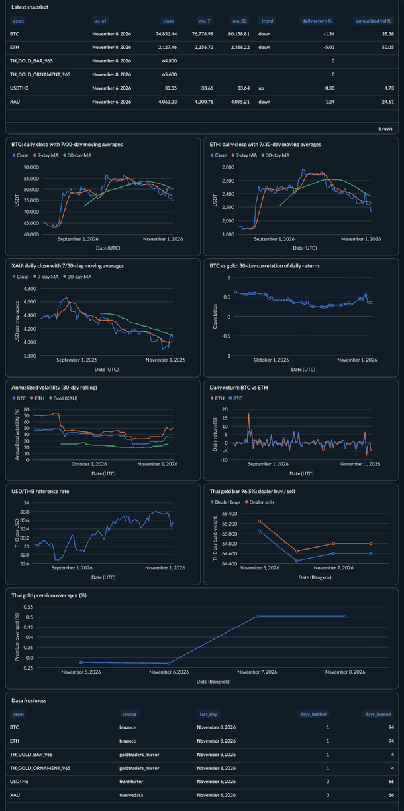

# Metabase dashboard



The "Market Overview" dashboard is defined in code (`scripts/setup_metabase.py`):
every question is native SQL over the `marts` schema, so the dashboard can be
rebuilt identically on any machine, and re-running the script updates it in place.

## 1. First-run setup (once, in the browser)

1. Open <http://localhost:3000> and create the Metabase admin account.
2. On **Add your data**, choose **PostgreSQL** and enter:

   | Field | Value | Why |
   |---|---|---|
   | Display name | `Warehouse` | the script looks the database up by this name |
   | Host | `postgres` | Metabase runs in a container; it reaches Postgres by service name, not `localhost` |
   | Port | `5432` | |
   | Database name | `warehouse` | our data, not Metabase's own `metabase` DB |
   | Username | `metabase_reader` | read-only role that can only see the `marts` schema |
   | Password | value of `METABASE_READER_PASSWORD` in `.env` | |

   Leave SSL off: traffic never leaves the Docker network on your machine.
   Watch out for browser autofill putting your Metabase login into the
   Username/Password fields.

## 2. Build the dashboard from code

Add the admin account you just created to `.env`:

```
METABASE_ADMIN_EMAIL=you@example.com
METABASE_ADMIN_PASSWORD=...
```

Then:

```bash
source .venv/bin/activate
set -a; source .env; set +a
python scripts/setup_metabase.py
```

It creates (or updates) a **Market Data Pipeline** collection with eleven questions
and the **Market Overview** dashboard, and prints the dashboard URL.

## What is on the dashboard

| Card | Source | Notes |
|---|---|---|
| Latest snapshot | `mart_moving_averages` + `mart_daily_volatility` | table: close, MAs, trend, return, vol per asset |
| BTC / ETH close with 7/30-day MA | `mart_moving_averages` | one chart per asset (different price scales) |
| Annualized volatility (30-day rolling) | `mart_daily_volatility` | all assets on one % axis |
| Daily return: BTC vs ETH | `mart_daily_volatility` | % change close-to-close |
| USD/THB reference rate | `fact_price` | business days only |
| XAU close with 7/30-day MA | `mart_moving_averages` | USD per troy ounce, trading days only |
| BTC vs gold: 30-day correlation | `mart_btc_gold_correlation` | fixed -1..1 axis so the size of the value reads correctly |
| Thai gold bar: dealer buy / sell | `fact_price` (bid/ask) | grows daily from the first capture; no history |
| Thai gold premium over spot (%) | `mart_thai_gold_premium` | weekends compare with Friday's spot and FX |
| Data freshness | `fact_price` + `dim_asset` | last day per asset; spot a stopped DAG |

## Design choices

- **No dual-axis charts.** BTC (~80,000 USDT) and ETH (~2,400 USDT) get separate
  charts; only series sharing a unit (percent volatility, percent return) share an axis.
- **Fixed series colors** from a palette checked for color-vision deficiency
  (blue `#2a78d6`, orange `#eb6834`, aqua `#1baf7a`). Aqua is below 3:1 contrast on
  white, so every chart keeps its legend and the snapshot table carries the numbers.
- **Read-only, least privilege.** Metabase connects as `metabase_reader`, which has
  `SELECT` on `marts` only (granted by default privileges in `infra/postgres/init.sh`),
  so new marts appear automatically and staging data is never exposed.
